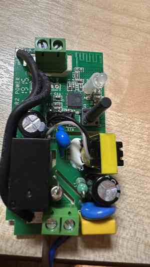
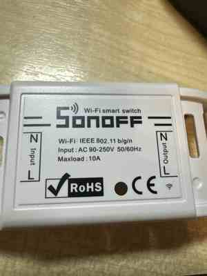
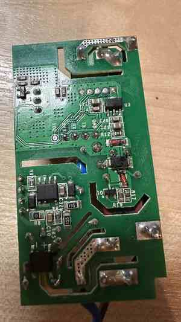
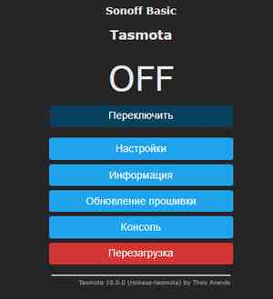
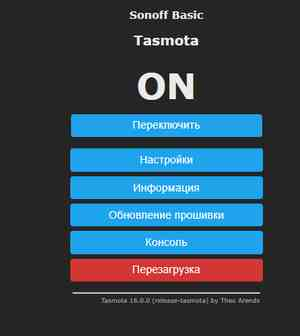

# iSonoff — SONOFF Basic + Tasmota + GoSHa AI OS

## Вторая жизнь облачного Wi‑Fi-реле SONOFF из эпохи 2016 года

**iSonoff** — практический проект модернизации старого **SONOFF Basic**, модели поколения приблизительно **2016 года**. Это бытовое Wi‑Fi-реле из ранней эпохи умного дома, рассчитанное на управление через экосистему **eWeLink**: штатная прошивка была ориентирована на фирменное приложение и облачный сервис производителя. Точный год изготовления именно этого экземпляра по фотографиям не установлен — 2016 год используется как ориентир для поколения устройства.

Вместо покупки нового выключателя мы сохранили его электронную начинку — электромеханическое реле, кнопку, светодиод, Wi‑Fi-антенну и контроллер — но **заменили оригинальную облачно-ориентированную прошивку на открытую Tasmota 16.0.0 RU**. Теперь SONOFF можно включать и выключать через веб-браузер **непосредственно в домашней локальной сети**, без сервера eWeLink и без обязательной регистрации у производителя. Для управления через локальный интерфейс доступ в интернет не требуется.

### Какой ESP стоит внутри?

Идентификация сделана не по внешнему виду, а непосредственно с помощью `esptool flash-id`: **Espressif ESP8285N08**, представитель семейства ESP8266/ESP8285 со **встроенной Flash-памятью 1 МБ**. Это **не ESP32**. Образ Tasmota использовался в режиме `DOUT` для Flash 1 МБ.

### Что реально изменили

**До:** заводское Wi‑Fi-реле SONOFF Basic, ориентированное на eWeLink и удалённое облачное управление.

**После:** тот же аппаратный выключатель, но с **Tasmota 16.0.0 RU**, локальным IP, веб-интерфейсом ON/OFF и возможностью дальнейшей интеграции в MQTT / **GoSHa AI OS**. MQTT пока не развёрнут: проверена именно работа локального веб-интерфейса.

Мы выполнили полную процедуру через **Windows PowerShell + USB-UART CH340 + esptool 5.6.0**: обнаружили ESP8285N08, **дважды считали заводской Flash**, сверили SHA‑256 обеих копий, стёрли Flash, записали русскую Tasmota и получили `Hash of data verified`. После подключения к локальному Wi‑Fi подтвердили не только надписи ON/OFF на экране, но и **реальные щелчки реле и переключение светодиода**. Оригинальные BIN-дампы оставлены локально и в GitHub не загружены, поскольку могут содержать секреты Wi‑Fi.

### Фотографии платы и результат перепрошивки

**1. Старое устройство и его плата**

| Вид со стороны компонентов | Оригинальный корпус | Обратная сторона печатной платы |
|:---:|:---:|:---:|
|  |  |  |
| Wi‑Fi-антенна на плате, ESP8285, реле, кнопка, светодиод и блок питания | Маркировка 90–250 В AC / до 10 А (по наклейке, не оценка безопасной нагрузки после переделки) | Медные дорожки силовой части, прорези электрической изоляции, площадки `RX`, `TX`, `3V3`, `GND` |

**2. Результат: управление реле из локального браузера**

| Реле выключено — OFF | Реле включено — ON |
|:---:|:---:|
|  |  |

На обеих фотографиях интерфейса — **Tasmota 16.0.0 (release-tasmota)**. Нажатие «Переключить» изменяет ON/OFF, приводит к щелчку реле и управляет индикатором.

> **Электробезопасность.** Открытая плата на фотографиях предназначена только для осмотра при **физически отключённой сети 220 В**. В ходе программирования нельзя соединять UART с устройством под сетевым напряжением — даже только RX/TX без GND. Проверка от штатного сетевого питания допустима лишь после отключения программатора, восстановления корпуса и безопасной сборки сетевой части.

---


Практическая документация **реально выполненного** перехода SONOFF Basic со штатной прошивки на **Tasmota 16.0.0 RU** с использованием **Windows PowerShell, CH340 USB-UART и esptool**.

> **Результат эксперимента (29.10.2026):** заводская флеш-память ESP8285 считана дважды, оба дампа по 1 048 576 байт совпали по SHA-256; Tasmota успешно записана и проверена; устройство подключилось к локальному Wi-Fi, а реле и индикатор переключаются через браузер.

**Этот репозиторий содержит документацию и вспомогательные PowerShell-скрипты. Он не является исходным кодом Tasmota и не содержит чужих прошивок.**

## Статус проекта

| Компонент / проверка | Фактический результат |
|---|---|
| Устройство | SONOFF Basic (профиль в веб-интерфейсе Tasmota) |
| Контроллер | ESP8285N08 |
| Flash | 1 MB (1 048 576 bytes), embedded |
| Кварц | 26 MHz |
| USB-UART | CH340, последовательный порт COM8 на момент прошивки |
| Среда | Windows PowerShell; Python 3.12; esptool 5.6.0 |
| Образ | `tasmota-RU.bin`, 672 448 байт, DOUT, 40 MHz, 1MB |
| Установленная версия | Tasmota 16.0.0 (сборка 2026-10-16) |
| Заводская прошивка | Два локальных побайтово совпадающих дампа |
| Проверка записи | `Hash of data verified` |
| Wi-Fi | DHCP-адрес получен; веб-интерфейс открыт |
| Реле и светодиод | ON / OFF с физическим щелчком — работает |
| MQTT | Пока не настроен |
| Интеграция с GoSHa AI OS | Запланирована, не выдаётся за выполненную |

Значения COM-порта и IP динамические: **не копируйте COM8 или чужой IP без проверки**.

## Быстрый маршрут

1. **[Безопасность и электрическое подключение](docs/01-safety-and-wiring.md)** — отделение сетевой части, контакты UART, питание 3,3 В.
2. **[Windows, драйверы, COM-порты](docs/02-windows-uart.md)** — CH340 / CP2102, драйверы и Loopback Test.
3. **[Вход в загрузчик и резервное копирование](docs/03-backup.md)** — `flash-id`, два чтения Flash, SHA-256.
4. **[Установка Tasmota RU](docs/04-flashing.md)** — загрузка BIN, `image-info`, `erase-flash` и `write-flash`.
5. **[Первый запуск, Wi-Fi и тест реле](docs/05-first-boot.md)** — настройка и контроль результата.
6. **[Ошибки и решения](docs/06-troubleshooting.md)** — отсутствие COM, `No serial data`, `Invalid head`, питание, ошибки терминала.
7. **[Интеграция с GoSHa AI OS](docs/07-gosha-integration.md)** — план MQTT и примеры команд без секретов.

## Минимальный набор

- SONOFF Basic с ESP8285 и доступным UART.
- USB-UART CH340 или CP2102 с **логическими уровнями 3,3 В**.
- **Стабильное питание 3,3 В с достаточным током**, предпочтительно >= 500 мА. Успех чтения Flash от конкретного адаптера **не доказывает**, что его выход выдержит Wi-Fi.
- Windows, Python, `esptool`, мультиметр.
- Провода/паяльное оборудование и безопасное рабочее место.

### Схема только низковольтной части

```text
 USB-UART                         SONOFF (отсоединён от сети!)
 TXD (3.3V logic) ---------------- RX
 RXD ----------------------------- TX
 GND ----------------------------- GND --- GND внешнего источника 3.3V
                                  3V3 --- +3.3V внешнего источника

 5V USB-UART  -- НЕ ПОДКЛЮЧАТЬ к SONOFF
 220V AC      -- НЕ ПОДКЛЮЧАТЬ при UART-программировании
```

Если **проверенный** USB-UART действительно рассчитан на ток ESP8285, отдельный источник может быть не нужен, но это требует проверки характеристик конкретного адаптера, а не только показания вольтметра без нагрузки. **Не объединяйте два независимых выхода 3,3 В.**

## Главная последовательность PowerShell

**Запускать только при безопасном низковольтном питании, физически отсоединённой сети 220 В и проверенной схеме.** COM заменять на актуальный.

Для входа в ROM-загрузчик: питание 3,3 В выключено → удерживать штатную кнопку SONOFF (GPIO0) → подать 3,3 В → через 1–2 секунды отпустить кнопку → открыть PowerShell → выполнять команды.

```powershell
py -m pip install --upgrade esptool pyserial
py -m esptool version
py -m serial.tools.list_ports -v

$Port = "COM8"  # Заменить актуальным COM
py -m esptool --chip esp8266 --port $Port --baud 115200 --before no-reset --after no-reset flash-id
```

При подтверждённом ESP8285 и объёме 1 MB:

```powershell
$BackupDir = Join-Path $env:USERPROFILE "Downloads\SONOFF_Backup"
New-Item -ItemType Directory -Force -Path $BackupDir | Out-Null

py -m esptool --chip esp8266 --port $Port --baud 115200 --before no-reset --after no-reset read-flash 0x0 0x100000 "$BackupDir\sonoff_original.bin"
if ($LASTEXITCODE -ne 0) { throw "Первое чтение не удалось" }

py -m esptool --chip esp8266 --port $Port --baud 115200 --before no-reset --after no-reset read-flash 0x0 0x100000 "$BackupDir\sonoff_original_check.bin"
if ($LASTEXITCODE -ne 0) { throw "Второе чтение не удалось" }

(Get-FileHash "$BackupDir\sonoff_original.bin" -Algorithm SHA256).Hash
(Get-FileHash "$BackupDir\sonoff_original_check.bin" -Algorithm SHA256).Hash
```

После сверки хешей см. [процедуру записи](docs/04-flashing.md). **Не запускайте стирание, пока не сохранены резервные копии.**

## Скрипты для повторяемости

- [`scripts/Backup-Sonoff.ps1`](scripts/Backup-Sonoff.ps1) — проверка модели/Flash, два чтения, сравнение SHA-256; не стирает и не пишет Flash.
- [`scripts/Flash-Tasmota.ps1`](scripts/Flash-Tasmota.ps1) — предварительные проверки, затем только **при явном подтверждении** стирание и запись.

Оба скрипта предполагают **уже выполненный ручной вход в загрузчик и безопасное питание 3,3 В**. Они не управляют электрической схемой и не устраняют опасности сетевого напряжения.

## Приватность и безопасность

- Не коммитьте `*.bin`, `*.dmp`, Wi-Fi SSID/пароли, MQTT-пароли, настоящие резервные копии и локальные конфигурации.
- Полный дамп может содержать учётные данные Wi-Fi; храните его отдельно и защищённо.
- Не соединяйте UART с SONOFF, который получает **сетевое питание**. Даже два сигнальных провода без GND **не делают схему безопасной**.
- Открытая плата и сетевые клеммы — источник риска поражения током. Эксплуатация от 220 В допустима лишь в полностью восстановленном безопасном корпусе с отсоединённым программатором; сетевые подключения — компетентным специалистом.
- Не публикуйте бытовые IP/MAC и идентификаторы устройств без необходимости.
- HTTP/MQTT доступны только в доверенной сети, с аутентификацией, без проброса портов в интернет.

## Проверенные факты и ограничения

Прошивка читалась и записывалась через PowerShell; первоначальный образ был скачан с официального сайта Tasmota. Реально проверено: два чтения, совпадение SHA-256, запись с `Hash of data verified`, запуск веб-интерфейса, переключение реле и индикатора. **Нагрузка на реле, стабильность после длительного времени, MQTT и GoSHa AI OS пока не проверялись.**

Документы отражают конкретный эксперимент, не гарантируют совместимости с иными ревизиями SONOFF.

## Ссылки и лицензии

- [Tasmota — Getting Started](https://tasmota.github.io/docs/Getting-Started/)
- [Tasmota — Esptool](https://tasmota.github.io/docs/Esptool/)
- [Tasmota — Commands](https://tasmota.github.io/docs/Commands/)
- [Tasmota — MQTT](https://tasmota.github.io/docs/MQTT/)
- [Официальные релизные BIN](https://ota.tasmota.com/tasmota/release/)
- [Espressif esptool](https://docs.espressif.com/projects/esptool/en/latest/)
- [Silicon Labs VCP Drivers](https://www.silabs.com/software-and-tools/usb-to-uart-bridge-vcp-drivers)

Исходники Tasmota: [arendst/Tasmota](https://github.com/arendst/Tasmota), лицензируются отдельно. Собственные тексты и скрипты этого репозитория — см. `LICENSE`.
